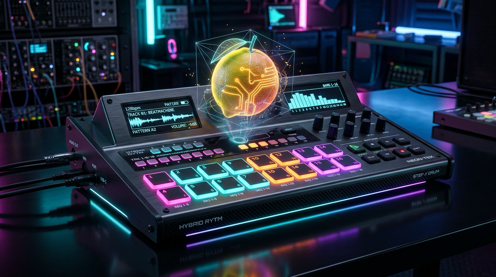

# openFruit 🍊⚡

> A slick, cyberpunk homage to the classic FL Studio pad tracker and step sequencer for playing samples, featuring an intelligent sonic analyzer, 16-channel MIDI mapping, per-row micro-timing, and live in-mix auditioning.



[](https://github.com/alanmarcero/openFruit/actions/workflows/build.yml)
[](LICENSE)

---

## Features

### 🎛️ 16-Track Matrix with Flexible Sizing
- **4, 8, 12, or 16 Tracks**: Quick toggle buttons on the top bar let you customize the view to fit your project scope.
- **Dedicated MIDI Channels (1–16)**: Each track corresponds 1:1 with its MIDI channel, prominently badged on the UI (`[CH 1]` through `[CH 16]`).

### 🥁 Classic Fruity Step Sequencer with Modern Precision
- **16 Cyberpunk Step Pads**: Familiar 4-beat alternating visual grouping with glowing neon bezels.
- **Micro-Timing per Row**: Select **1/16**, **1/32**, or **1/64** timing resolution individually for each track row.
- **Pad Pitch Tuning (+/- 24 Semitones)**: Right-click or mouse-wheel on any active step to dial in chromatic offsets up to 2 octaves up or down with live on-pad badges.
- **Pad Velocity**: Fine-tune per-step velocity with an on-pad LED level gauge.

### 📄 Automatable Pattern Pages (A, B, C, D)
- 4 distinct pattern pages per track.
- Seamlessly switch variations via top buttons or **DAW automation** via the `page` host parameter.

### 🎹 Dual Input Modes
- **Pad Sequencer Mode**: The step sequencer drives sample playback locked to host tempo and transport.
- **MIDI Mode**: Disables internal step pads and hands complete control over to incoming MIDI. Incoming note numbers determine pitch transposition (-24 to +24 semitones relative to C3) and note velocity controls sample dynamics.

### 🔬 Intelligent Sonic Analyzer & Audio Browser
- **Tone & Pitch Estimation**: High-speed Normalized Square Difference Function (NSDF) pitch detector calculates dominant frequencies (Hz) and musical notes (`A4`, `C#1`, `F2`) with cents precision in sub-milliseconds.
- **Sort by Sample Length**: Quickly organize files by duration (shortest to longest or vice-versa) to isolate one-shots from long loops.
- **Live In-Mix Auditioning**: As you browse through folders, samples auto-play. Even better: **any incoming MIDI on that track's channel triggers the previewed sample live in your host mix** at tempo before committing!
- **Folder Analysis Queue & Cache**: Automatically queues files in the selected directory 5 at a time in the background. Results are cached to avoid re-analysis, with a one-click **Clear Tone Cache** button.

### 🎨 Cyberpunk & Retro Color Themes
- **Cyberpunk Neon** (Default): Hot neon magenta, electric cyan, and cyber orange accents on dark brushed gunmetal.
- **Fruity Classic**: Vintage FL charcoal chassis with iconic 4-beat orange and green pad groupings.
- **Synthwave Outrun**: Deep violet, hot pink, sunset amber, and neon teal.
- **Acid Matrix**: Phosphor green and terminal amber on deep obsidian.

---

## Architecture

- `Source/Core`:
  - `SonicAnalyzer`: Sub-millisecond monophonic pitch detection and musical note converter.
  - `ToneCache`: Thread-safe persistent cache for analyzed sample metadata.
  - `AnalysisQueue`: Background worker queue processing folders 5 files at a time.
  - `SampleVoice`: Hermite cubic-interpolated resampling engine with +/-48 semitone total pitch range and constant-power stereo panning.
  - `FruitEngine`: 16-track sample tracker engine handling transport clocking, voice polyphony, and MIDI routing.
- `Source/Plugin`:
  - `Parameters`: APVTS host automatable parameter layout.
  - `DefaultKit`: 16 procedural EDM drum & synth samples generated at launch.
  - `Controls`: Custom-drawn `CyberStepPad` and `TrackRowComponent` widgets.
  - `SampleBrowserModal`: Audio file browser with real-time tone analyzer table and live auditioning.
  - `Panels`: Faceplate header and responsive tracker grid viewport.

---

## Building from Source

### Prerequisites
- CMake 3.22+
- C++20 compliant compiler (Apple Clang 15+, GCC 12+, Clang 16+, MSVC 2022)
- macOS, Linux, or Windows

### Build Instructions

```bash
git clone https://github.com/alanmarcero/openFruit.git
cd openFruit

# Configure with CMake
cmake -B build -DCMAKE_BUILD_TYPE=Release

# Build plugin and standalone formats
cmake --build build --config Release --parallel

# Run Unit Tests
ctest --test-dir build --output-on-failure
```

The built bundles will be located in `build/OpenFruit_artefacts/`:
- **VST3**: `build/OpenFruit_artefacts/VST3/openFruit.vst3`
- **AU**: `build/OpenFruit_artefacts/AU/openFruit.component`
- **Standalone**: `build/OpenFruit_artefacts/Standalone/openFruit.app`
- **LV2**: `build/OpenFruit_artefacts/LV2/openFruit.lv2`

---

## License

MIT License. Copyright (c) 2026 Alan Marcero. See [LICENSE](LICENSE) for details.
