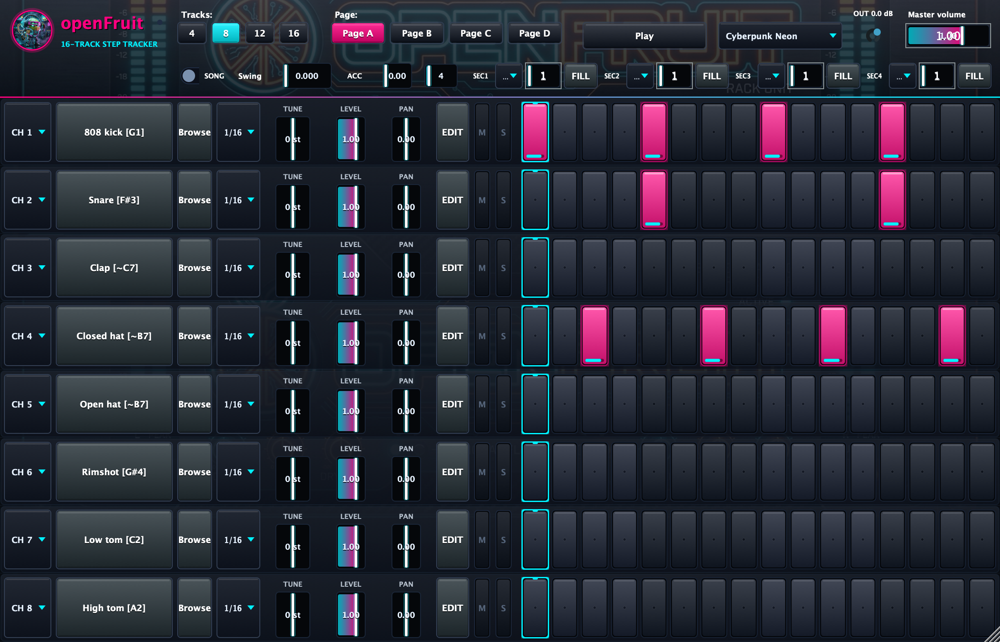
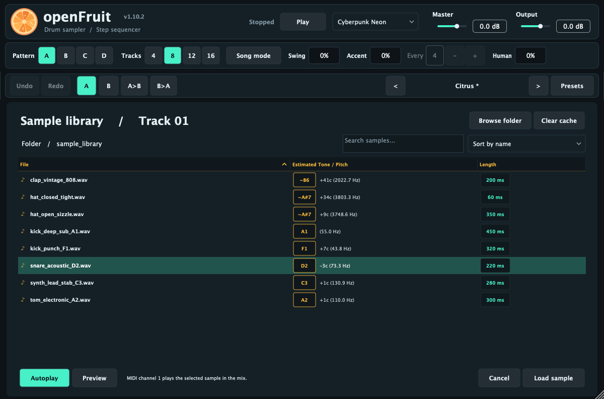

# openFruit

A step sequencer and sample player for drum patterns. Create patterns one hit at a time, then arrange four pages into a song.

[Download the latest release](https://github.com/alanmarcero/openFruit/releases/latest) · [Install with OpenVST Manager](https://github.com/alanmarcero/alan-m-OpenVSTManager/releases/latest)

## Make patterns

- Choose 4, 8, 12, or 16 tracks. Each has a sample, MIDI channel (1–16), level, pan, tuning (±24 semitones), mute, and solo.
- Shape each track with a low-pass filter and attack, decay, sustain, and release controls. Add timing nudge and groove.
- Each page has 16 steps per track. Set velocity and pitch for each step, up to two octaves in either direction.
- Right-click a step to set its probability, 1–8 repeats, timing offset, sample start and end, reverse playback, or choke group.
- Choose each track's step rate: 1/16, 1/32, or 1/64. Add global swing and set the accent amount and interval, from every 2–16 steps.
- Switch between pages A–D with the editor or host automation. Song Mode chains four sections with a page, 1–32 bars, and an optional final-bar fill from Page D.
- Play or pause in the editor, or sync to your host transport. Incoming MIDI triggers tracks on their selected channels.
- Adjust master volume. Output trim ranges from −24 to +12 dB. The plugin saves patterns and settings with your DAW session.

## Browse samples

Browse folders and subfolders. Auto Play previews the selected sample; Preview replays it, and Load assigns it to the track. Clear cached pitch results when needed. A track pad also auditions its sample. Incoming MIDI on that track's channel can play the selected browser sample.

The browser estimates each sample's pitch and note, then sorts files by length, name, or pitch. Supported files include WAV/BWF, AIFF/AIFC, MP3, FLAC, Ogg Vorbis, M4A/AAC/MP4/M4R, CAF, ALAC, WMA, Opus, AU, SND, and WV. Support can vary by system.

Choose a Cyberpunk Neon, Fruity Classic, Synthwave Outrun, or Acid Matrix editor theme. The plug-in starts with eight active tracks and a built-in sample kit.

## Formats

VST3 and LV2 for macOS, Windows, and Linux; AU for macOS; standalone apps for all three platforms.

## License

MIT. See [LICENSE](LICENSE).
