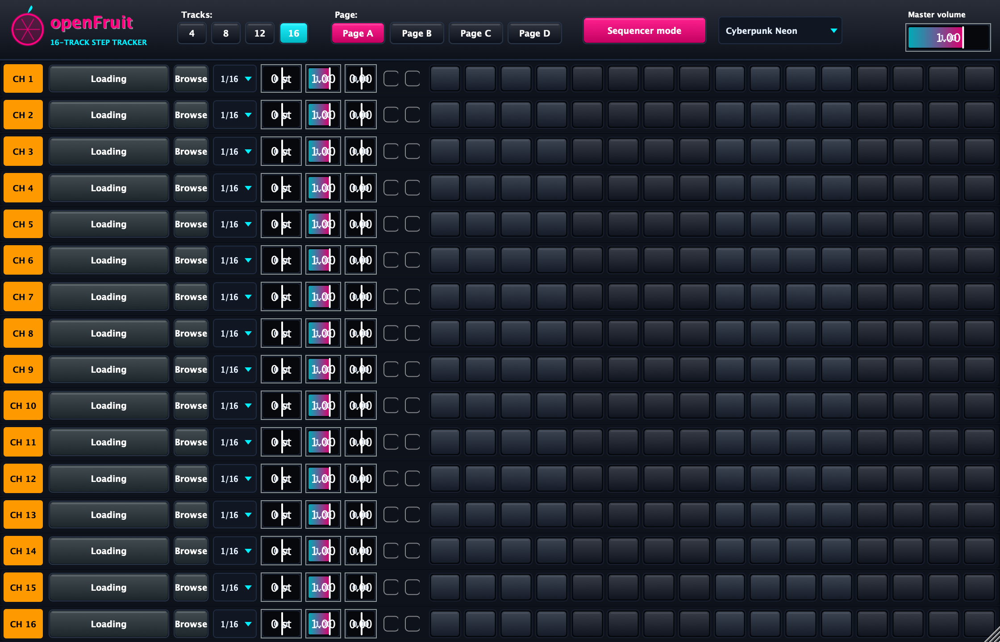
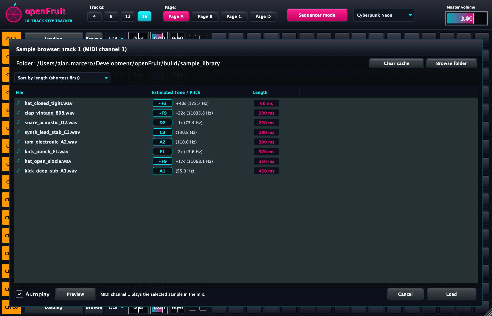

# openFruit

A 16-track step sequencer and sample player based on the classic FL Studio pad tracker layout. It supports variable track counts, per-row micro-timing, pitch detection in the sample browser, and live MIDI auditioning.





## Features

- Track counts: 4, 8, 12, or 16 active tracks.
- MIDI routing: tracks 1 through 16 map directly to MIDI channels 1 through 16. The active channel is shown on each row badge.
- Step sequencer: 16 pads per row with 4-beat color groupings.
- Row timing: 1/16, 1/32, or 1/64 timing selectable per row.
- Tuning: +/- 24 semitones per step pad and +/- 24 semitones base tuning per track.
- Velocity: adjustable per step pad.
- Pattern pages: pages A, B, C, and D switchable by parameter automation or UI buttons.
- Input modes: sequencer mode uses internal step pads; MIDI mode ignores pads and maps incoming notes to pitch offsets.
- Pitch analysis: the sample browser runs a pitch detector over files in the selected folder, estimating fundamental frequency and musical note.
- File sorting: sort samples by duration, name, or detected pitch.
- Tone cache: stores pitch calculations on disk at `~/.openfruit/tone_cache.tsv` to prevent repeated analysis.
- Live auditioning: selecting a sample plays it immediately, and incoming MIDI on that track's channel triggers the previewed sample in the host mix.
- Themes: Cyberpunk Neon, Fruity Classic, Synthwave Outrun, and Acid Matrix.

## Architecture

- `Source/Core/SonicAnalyzer.cpp`: monophonic fundamental frequency and note detection.
- `Source/Core/ToneCache.cpp`: disk cache for analyzed sample metadata.
- `Source/Core/AnalysisQueue.cpp`: worker thread analyzing up to 5 files at a time per folder.
- `Source/Core/SampleVoice.cpp`: cubic interpolation resampling playback with panning.
- `Source/Core/FruitEngine.cpp`: 16-track audio engine, clock advance, voice allocation, and MIDI handling.
- `Source/Plugin/`: JUCE audio processor, APVTS parameters, custom step pads, sample browser modal, and layout panels.

## Pitch detection algorithm

The sonic analyzer estimates sample pitch through `SonicAnalyzer::analyze` using the following steps:

1. Window selection: audio is downmixed to mono, and an analysis window of up to 4096 samples is selected around the sound body, bypassing initial attack transients where noisy impact energy can mask the fundamental tone.
2. Normalized square difference function (NSDF): calculates autocorrelation normalized across lags corresponding to 25 Hz through 2400 Hz:
   `r(tau) = (2 * sum(x[j] * x[j + tau])) / (sum(x[j]^2) + sum(x[j + tau]^2))`
   Values are bounded between -1.0 and +1.0, with values close to 1.0 indicating periodic alignment.
3. First-peak selection: finds all local maxima in the NSDF curve. To prevent octave errors from integer period multiples, it selects the first local maximum whose value meets a dynamic threshold of `max(0.40, 0.80 * max_peak_value)`.
4. Parabolic interpolation: fits a parabola across the discrete peak lag index and its two immediate neighbors, resolving fractional period length to sub-sample precision:
   `delta = (r[tau + 1] - r[tau - 1]) / (2 * (2 * r[tau] - r[tau - 1] - r[tau + 1]))`
   `f0 = sample_rate / (tau + delta)`
5. Musical note mapping: converts estimated frequency `f0` in Hz to the nearest chromatic MIDI note number:
   `midi = 69 + 12 * log2(f0 / 440)`
   The fractional remainder determines detune in cents (`+/- 50c`), and the integer note maps to standard pitch notation (`C3`, `F#1`, `A4`). For inharmonic or noisy percussive sounds without a dominant harmonic peak above the confidence threshold, the analyzer estimates the dominant resonant body frequency and zero-crossing rate to report the closest chromatic pitch with detune cents.

## Build instructions

Requires CMake 3.22 or newer and a C++20 compiler.

```bash
git clone https://github.com/alanmarcero/openFruit.git
cd openFruit
cmake -B build -DCMAKE_BUILD_TYPE=Release
cmake --build build --config Release --parallel
ctest --test-dir build --output-on-failure
```

Output paths:
- VST3: `build/OpenFruit_artefacts/VST3/openFruit.vst3`
- AU: `build/OpenFruit_artefacts/AU/openFruit.component`
- Standalone: `build/OpenFruit_artefacts/Standalone/openFruit.app`
- LV2: `build/OpenFruit_artefacts/LV2/openFruit.lv2`

## License

MIT License. See [LICENSE](LICENSE) for details.
