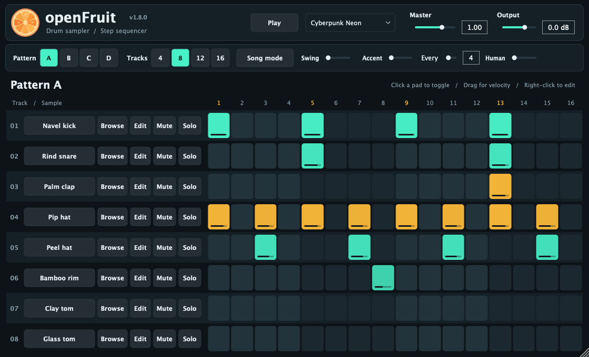
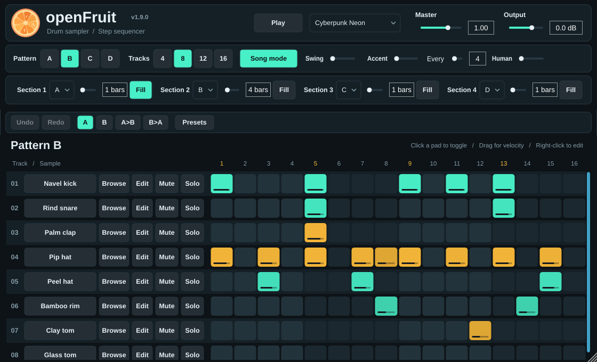
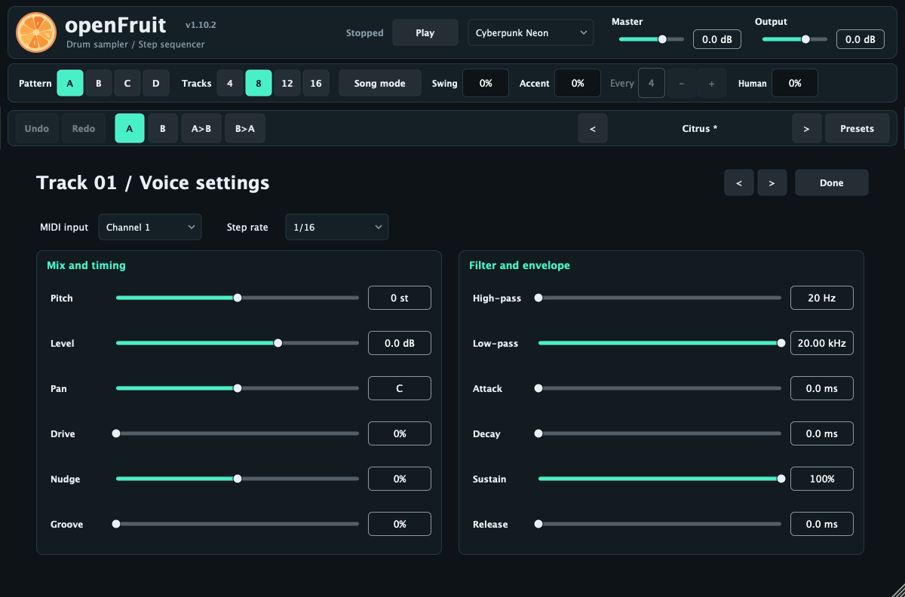

# openFruit

A step sequencer and sample player for drum patterns. Create patterns one hit at a time, then arrange four pages into a song.

[Download the latest release](https://github.com/alanmarcero/openFruit/releases/latest) · [Install with OpenVST Manager](https://github.com/alanmarcero/alan-m-OpenVSTManager/releases/latest)

## Play a pattern

Press **Play** to start the sequencer and arm host sync. The citrus wheel turns once per four quarter notes and follows tempo changes and seeks. In standalone it follows the sequencer’s internal clock. Select **A**, **B**, **C**, or **D** to edit a page. Their startup phrases cover a straight floor groove, syncopated hats, halftime and a tom fill.

Click a sample name to audition it. Click any of its 16 pads to toggle a hit, drag vertically for velocity, or scroll and right-drag for pitch. Right-click for probability, 1–8 ratchets, timing offset, sample start and end, reverse playback, and choke group. Mute and Solo are beside the sample. Select 4, 8, 12 or 16 tracks. Larger patterns scroll vertically at compact sizes.

**Song mode** reveals four sections. Choose the page and length for each (1–32 bars). **Fill** plays page D during the final bar. Global swing delays alternate steps. Accent sets periodic emphasis and its interval, from 2 to 16 steps. The master level and output trim (−24 to +12 dB) sit beside the transport.

## Shape a track

**Edit** opens its MIDI channel, step rate (1/16, 1/32, 1/64), pitch (±24 semitones), level, pan, low-pass filter, nudge, groove, and attack, decay, sustain and release envelope. Incoming MIDI plays the track on its selected channel. Each step also has ±24 semitones of tuning.

The Citrus kit has 16 synthesized one-shots. A swept kick, layered snare, retriggered clap and two metallic hats share the kit with tuned wood percussion, sub bass, chord stab, zap and ride. Pitched-up playback averages the source between output samples to reduce folded high frequencies in both forward and reverse playback.

## Browse and recall samples

**Browse** opens the sample library for that lane. Choose or drop a folder or audio file. Sort by duration, name or estimated pitch. **Autoplay** auditions each selection. **Preview** replays it, and **Load sample** assigns it to the track. The selected file also responds to incoming MIDI on the track’s channel.

The browser handles WAV/BWF, AIFF/AIFC, MP3, FLAC, Ogg Vorbis and additional formats supplied by the operating system. Sessions save file paths, patterns and automation. Keep source audio files at those paths. Projects saved by an earlier version reopen with the original factory kit and their stored patterns. The four editor themes use dark backgrounds.

## Formats

VST3 and LV2 for macOS, Windows, and Linux; AU for macOS; standalone apps for all three platforms.

## License

MIT. See [LICENSE](LICENSE).
